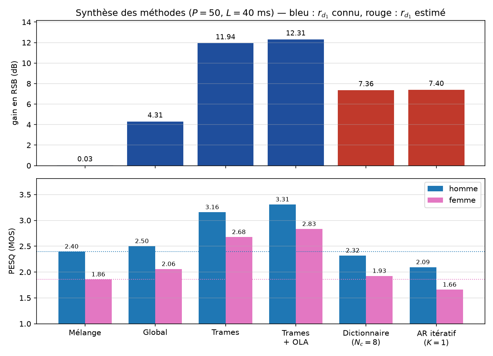

# Wiener filter denoising — from a noisy sine wave to separating two voices

**Optimal (Wiener) filtering applied step by step: a noisy harmonic, a real audio recording, then separating two mixed voices, evaluated with SNR gain and PESQ (the standard speech-quality score used in telecoms).**

Lab project for the *Digital Signal Processing* course at INSAT (telecom engineering, 4th year). MATLAB for the experiments, Python for PESQ, LaTeX for the report ([`main.pdf`](main.pdf), in French).

<p align="center">
  
</p>

## What I did

The Wiener filter is the linear filter that minimizes the mean squared error between its output and the wanted signal. It is obtained by solving

$$\mathbf{R}_x\,\mathbf{w}_{opt}=\mathbf{r}_{dx},\qquad \mathrm{MSE}_{\min}=r_d(0)-\mathbf{w}_{opt}^T\,\mathbf{r}_{dx}$$

with the statistics estimated by time averages.

1. **Background** — Norbert Wiener (optimal filtering, cybernetics) and Bernard Widrow (the LMS algorithm, ADALINE), and how the adaptive LMS filter converges to the same solution without knowing the statistics.
2. **Noisy sine wave** — effect of the filter order *P* on the error and on the SNR gain; theory vs. simulation.
3. **Real audio signal** — global filter vs. frame-by-frame filtering, choice of frame length, limits with colored noise and non-stationarity.
4. **Separating two voices** (a male and a female speaker mixed together) — global filter, frame-by-frame filtering, overlap-add, a *k*-means dictionary when the target voice is unknown, and an iterative AR-model filter; all compared with SNR gain and PESQ.

## Key results

**Filter order.** The minimum error drops with *P* then plateaus: *P* ≈ 25 for the sine wave (≈ 11 dB of gain), *P* = 10 for the audio signal, whose correlation decays quickly.

**Voice separation** (*P* = 50, 40 ms frames):

| Method | Target voice statistics | SNR gain (dB) | PESQ male | PESQ female |
|---|---|---|---|---|
| Mixture (no processing) | – | 0.03 | 2.40 | 1.86 |
| Global filter | known | 4.31 | 2.50 | 2.06 |
| 40 ms frames | known | 11.94 | 3.16 | 2.68 |
| **Frames + overlap-add** | known | **12.31** | **3.31** | **2.83** |
| *k*-means dictionary (8 atoms) | estimated | 7.36 | 2.32 | 1.93 |
| Iterative AR filter (1 iteration) | estimated | 7.40 | 2.09 | 1.66 |

- A global filter only sees the average spectra and separates little (+4.3 dB). On short frames, one voice dominates most of the time, so frame-by-frame filtering with overlap-add reaches **+12.3 dB** and clearly better perceived quality (PESQ 2.40 → 3.31).
- When the target voice's statistics must be **estimated** (realistic case), the gain falls to about 7.4 dB and perceived quality stays close to the mixture: the interference is itself speech.

## What I learned

- An SNR gain can rise while the sound gets worse: frame boundaries create clicks the metric does not see. Perceptual scores like PESQ matter.
- The Wiener filter is only as good as its statistics: assuming stationarity and known spectra is what breaks first on real signals.
- Frame length is a trade-off between tracking non-stationarity and estimating statistics reliably (20–50 ms worked best for speech).
- These limits motivate adaptive filtering (LMS), which learns the coefficients sample by sample — the natural next step of this work.
- Practical side: MATLAB's PESQ implementation no longer ran, so I exported the signals and computed PESQ in Python (`pesq` package).

## Repository

```
main.pdf          full report (French)
main.tex          report entry point, sections/ holds one file per part
figures/          figures used in the report
TP2_Matlab/       MATLAB scripts, one folder per part (Partie2, Partie3, Partie4)
                  Partie4/pesq_synthese.py computes the PESQ table in Python
```

## Run it

- **MATLAB:** go to a part's folder (e.g. `cd TP2_Matlab/Partie3`) and run its scripts; each saves its figures next to it.
- **PESQ (part 4):** run `Q7_export.m` in MATLAB to export the signals, then:
  ```bash
  pip install numpy scipy matplotlib pesq
  python pesq_synthese.py
  ```
- **Report:** `latexmk` at the root builds `main.pdf`.
